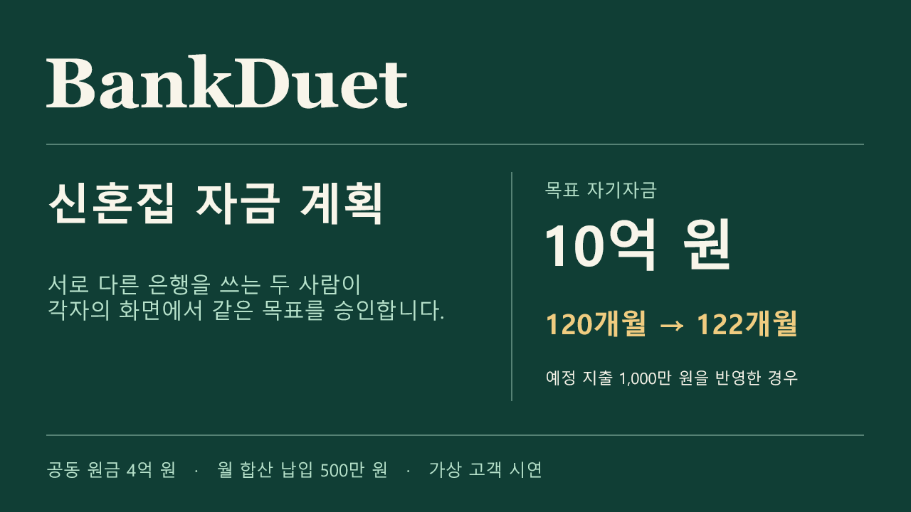
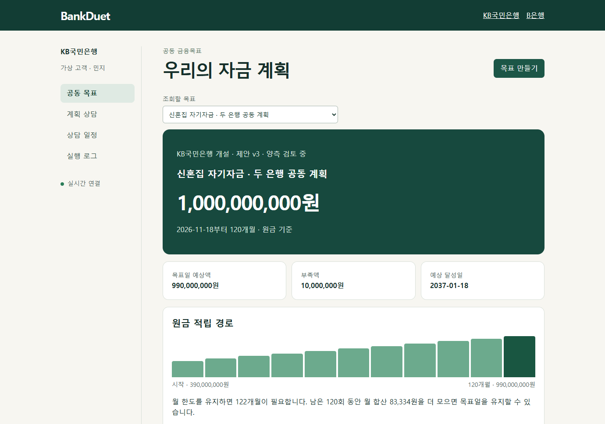
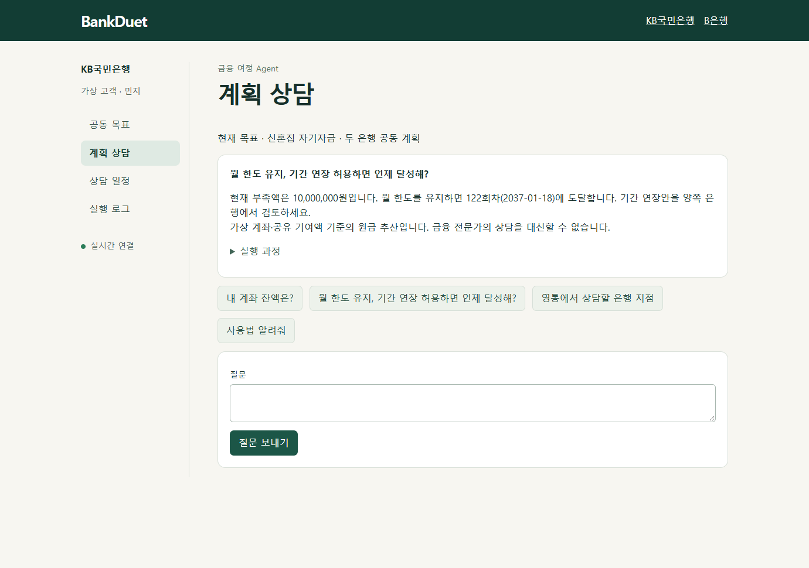
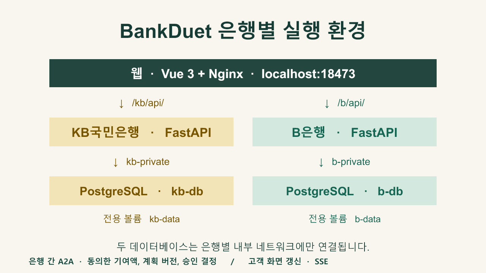

# BankDuet

서로 다른 은행을 쓰는 신혼부부가 **신혼집 자기자금을 함께 계획하고, 각자의 은행에서 같은 수정안을 승인하는** 금융 서비스입니다.

[실행 방법](#로컬-실행) · [실제 화면](docs/evidence/kb-gap.png) · [검증 결과](docs/검증.md) · [프로젝트 소개 PPT](docs/design/BankDuet_도해.pptx)



## 1,000만 원을 쓰면 신혼집은 언제 살 수 있을까?

민지와 준호의 초기 자금은 합쳐서 4억 원입니다. 매달 500만 원씩 모으면 120개월 뒤 10억 원이 됩니다. 준호가 예정 지출 1,000만 원을 등록하면 같은 날의 예상액은 **9억 9,000만 원**입니다. 월 납입액을 유지하려면 두 달이 더 필요합니다.

| 준호의 B은행 | 민지의 KB 화면 |
|---|---|
| 준호가 지출 금액과 사유를 입력합니다. | 동의한 기여액이 도착하면 부족액이 갱신됩니다. 지출 사유는 B은행에 보관합니다. |
| 준호가 122개월 수정안을 제안합니다. | 민지가 같은 버전을 검토합니다. **양쪽이 모두 승인**하면 새 계획이 확정됩니다. |

| 공동 목표에 반영된 부족액 | 월 납입액을 유지하는 상담안 |
|---|---|
| [](docs/evidence/kb-gap.png) | [](docs/evidence/chat.png) |

## 기술 선택

| 설계 질문 | 구현 |
|---|---|
| 은행별 데이터를 어떻게 분리할까? | 은행마다 FastAPI와 PostgreSQL 16 인스턴스를 따로 두고, A2A로 공유에 동의한 기여액과 승인 결정을 전달합니다. |
| 참여 은행이 잠시 멈추면? | 계획 변경과 발송할 메시지를 한 트랜잭션에 저장합니다. 복구 후 재전송하고 수신 측은 메시지 ID로 중복을 걸러냅니다. |
| 상대방이 수정한 계획은 어떻게 보일까? | Vue 3·TypeScript 화면이 SSE로 변경을 감지하고 자기 은행의 최신 계획을 조회합니다. |
| AI 상담은 무엇을 판단할까? | LangGraph가 계좌 조회와 재계획을 연결합니다. 영통 지점 문의에서는 SSAFY GMS가 검색 도구를 선택하고 카카오 로컬 API가 실제 지점 3곳을 반환했습니다. |

은행 계좌와 저축 이력은 **합성 데이터**입니다. 목표 금액은 고객이 정하며 예상 달성일은 이자와 집값 변동을 제외한 원금 기준입니다. [GMS·카카오 실호출 기록](docs/검증.md#영통-지점-검색-실호출)

<details>
<summary>은행별 API와 PostgreSQL 구성도</summary>



</details>

## 로컬 실행

Docker Desktop(Linux 컨테이너)과 Compose v2를 사용합니다. 처음 실행할 때 저장소 루트의 `.env.example`을 `.env`로 복사한 뒤, `KB_DB_PASSWORD`와 `B_DB_PASSWORD`에 서로 다른 비밀번호를, `BANK_PEER_SECRET`에 은행 간 통신용 비밀값을 입력합니다.

```powershell
docker compose up -d --build --wait
```

[KB · 민지](http://localhost:18473/kb/)에서 **목표 만들기** → [B은행 · 준호](http://localhost:18473/b/)에서 **변경값 자동 공유** → 양쪽에서 **같은 버전 승인**을 선택합니다. 이후 B은행에서 **지출 반영**을 눌러 민지 화면의 부족액 변화를 확인합니다.

<details>
<summary>GMS·카카오 연결과 실행 관리</summary>

지점 검색까지 시연하려면 `.agent.env.example`을 `.agent.env`로 복사하고 `GMS_KEY`와 `KAKAO_REST_API_KEY`를 채운 뒤 위 실행 명령을 다시 실행합니다. [KB 상담](http://localhost:18473/kb/chat)에서 “영통에서 상담할 은행 지점을 찾아줘”라고 입력합니다. 키 없이도 공동 목표와 규칙 기반 상담을 시연할 수 있습니다.

상태 확인은 `docker compose ps`, 종료는 `docker compose stop`입니다. 은행별 데이터는 전용 볼륨에 보존됩니다. 기존 볼륨의 비밀번호를 바꾸려면 DB 사용자 설정도 함께 변경해야 합니다.

</details>

## 검증과 문서

통합 검증 **19개**를 통과했고, 별도 브라우저 두 창에서 지출 반영과 오프라인 복귀 후 재승인을 확인했습니다. B은행 API가 중단된 동안 생성한 목표도 복구 후 두 은행에서 확정됐습니다. [검증 결과서](docs/검증.md) · [실행 기록](docs/evidence/journey-smoke.json)

| 기획 | 구현 | 검증 |
|---|---|---|
| [요구사항 정의서](docs/요구사항.md) | [Agent 설계서](docs/Agent설계.md) · [Tool 정의서](docs/Tool정의.md) | [요구사항별 체크리스트](docs/체크리스트.md) |
| [프로젝트 소개 PPT · 8장](docs/design/BankDuet_도해.pptx) | [API 명세서](docs/API.md) · [OpenAPI](docs/evidence/openapi.json) | [로컬 Swagger](http://localhost:18473/kb/api/docs) |
