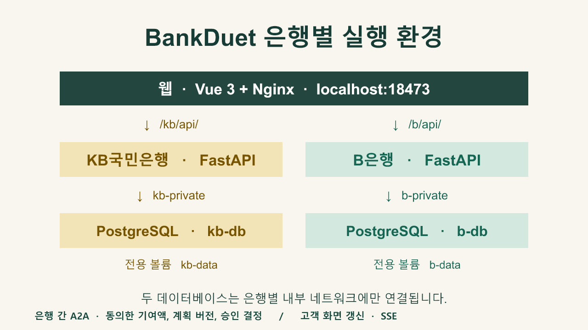
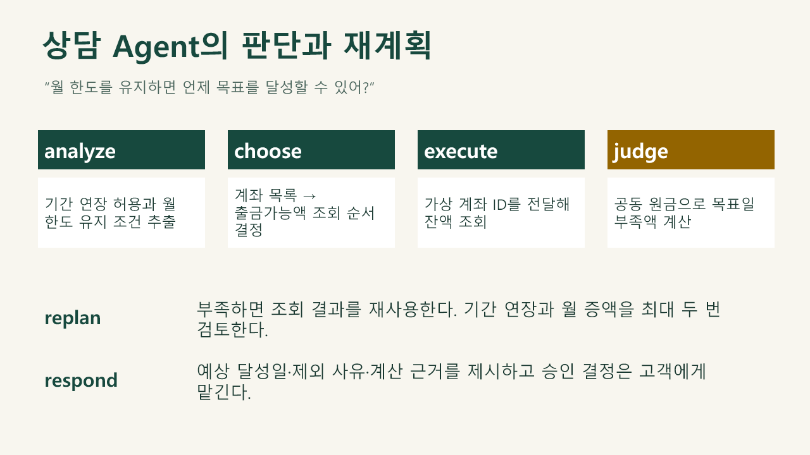
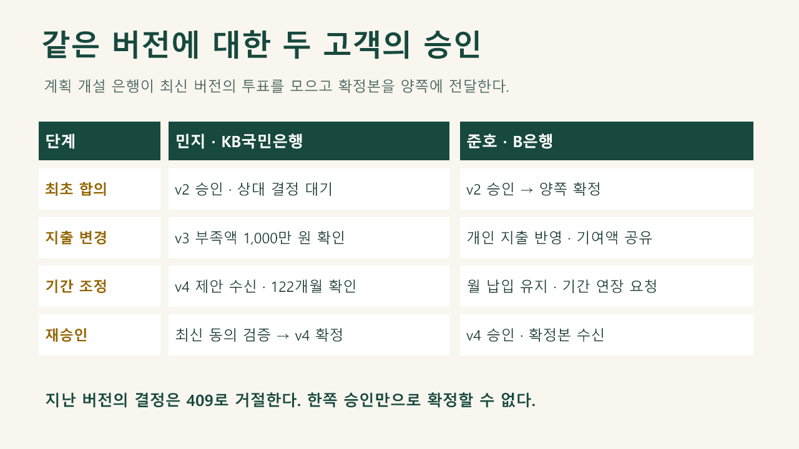

# 은행별 Agent 설계

각 은행은 동일한 FastAPI 코드와 독립된 PostgreSQL 인스턴스를 사용한다. 고객의 지출 사유·모킹 잔액·비상금·상담 대화·일정·실행 로그는 자기 은행 DB에 저장한다. 목표 개설 은행은 양쪽이 동의한 초기 기여액·월 납입액·회차별 조정액·동의 기한과 버전별 결정을 취합한다.

## 월별 원금 계산

각 은행의 가상 원장은 직전 3개월의 저축 이체 240만·260만·250만 원을 제공한다. 월 평균 250만 원을 최초 납입액으로 제안하며, 고객은 자기 은행에서 이를 수정할 수 있다. 이체 이력은 자기 은행의 ‘최근 3개월 저축 이력’에서 확인한다.

자기 은행의 초기 기여액은 현재 잔액에서 비상금, 미출금 예정 지출, 이미 납입한 금액을 차감한 금액이며 최솟값은 0원이다. 이미 납입한 금액은 해당 회차에 실제 금액으로 다시 합산한다. 예정 지출을 출금 처리하면 잔액과 미출금 합계가 함께 줄어들어 결과는 같다.

**n회차 예상 원금** = 공동 초기 기여액 + (월 합산 납입액 × n) + 정산한 회차의 납입 차액 합계

납입 차액은 각 회차의 실제 납입액에서 예정액을 뺀 값이다. 누락 회차의 실납입액은 0원이다. 목표에 처음 도달하는 회차를 구하고 말일이 짧은 달은 해당 월 말일을 사용한다. 부족액을 남은 회차로 나눠 원 단위로 올림하면 같은 날짜에 필요한 월 추가 납입액이다. 이미 입력한 가장 최근 회차까지는 정산한 것으로 본다. 금리·세금·주택 가격 변동은 계산에 포함하지 않는다. [계산 소스](../backend/app/finance.py)

## 상담 처리

| 단계 | 입력과 결과 |
|---|---|
| analyze | 질문과 은행 내 세션 메모리에서 목적, 지역, 연장 허용 여부, 가정할 월 납입액과 기간을 추출한다. |
| choose | 조회 순서를 정한다. 환경에 모델이 설정되면 함수 스키마를 보내 첫 Tool의 선택을 검사한다. 도움말은 Tool 호출 0회, 지역과 목표가 빠진 질문은 추가 정보를 요청한다. |
| execute | 가상 계좌 후보 ID로 잔액을 조회하고 지점 요청은 장소 검색으로 보낸다. 결과와 실패 코드를 Tool별로 기록한다. |
| judge → replan | 확정된 수치로 목표를 검토하고, 부족하면 기존 Tool 결과를 재사용해 기간 연장과 월 증액을 차례로 검토한다. 최대 두 번이다. |
| respond | 결과·추산 근거·제약을 답변하고 세션에 반영한다. 상담에서 입력한 금액과 기간은 모의 계산에만 사용한다. |

계획과 대화를 연결하는 키는 목표 ID다. 은행·세션 ID별로 이전 조건을 저장하고 목표가 바뀌면 상담 조건을 초기화한다. 메인 Agent는 직전 실행에서 이상이 검출되면 등록된 로컬 Tool 계획을 사용한다. 로거는 실행 이벤트의 구독자로 작동한다. 로그 저장 실패가 상담을 중단시키지 않으며, 진단은 별도의 요청으로 실행한다. [Agent](../backend/app/agent.py) · [이벤트 구독](../backend/app/events.py)

## 승인과 장애 복구

| 상황 | 처리 방식 |
|---|---|
| 상대 은행 중단 | 자행 상태 변경과 발송할 메시지를 함께 커밋한다. 복구 후 순서대로 재전송한다. |
| 중복·지연 수신 | 메시지 ID로 중복을 제거하고 더 높은 순번의 개설 은행 스냅숏을 적용한다. |
| 조건 변경 중 승인 도착 | 새 버전에 대해 두 고객의 승인을 다시 받는다. 확정 시 상대의 최신 동의 버전을 확인할 수 없으면 결정을 보류한다. 이전 확정본은 이력에 남는다. |

한 번 공유하면 금액 변경은 재동의 전까지 타행에 전달되지 않는다. 자동 공유는 동의 시점부터 30일 동안 유효하다. 동의 철회 시 상대 기여액이 공동 전망에서 빠진다. 이미 본 확정 내역은 이력에 남는다. UI는 은행별 SSE를 구독하고 변경 시 최신 계획을 다시 읽는다. 브라우저의 연결 복귀 시에는 스냅숏과 커서를 다시 가져온다. [협의 처리](../backend/app/journeys.py) · [전송 및 재시도](../backend/app/transport.py)

[프로젝트 홈](../README.md) · [전송 방식 비교](검증.md#전달-방식-비교)
