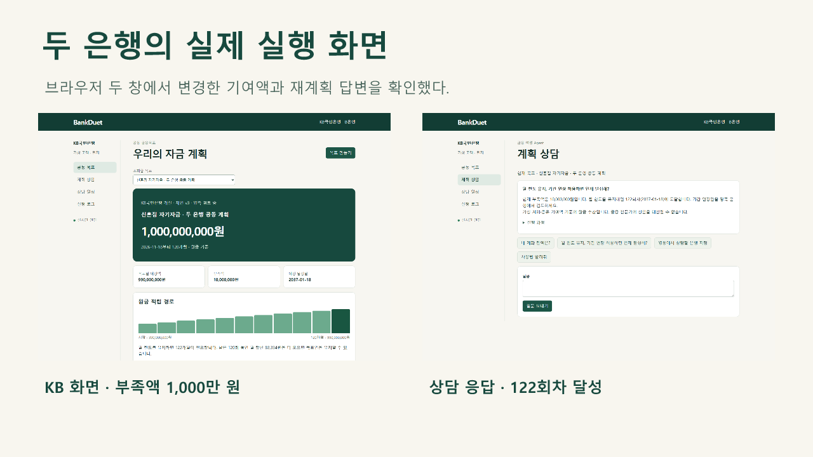
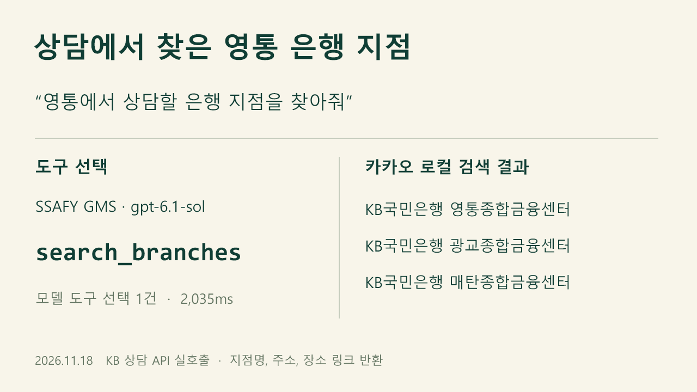

# BankDuet 검증 결과

2026-11-18 Windows · Docker Desktop(Linux) · PostgreSQL 16 · Edge 헤드리스에서 시험했다. 시연 포트는 18473, 별도 볼륨을 쓰는 시험 환경은 18474다. 아래 결과는 각 은행에 가상 고객 1명씩 둔 개발 환경의 관찰값이다.

| 시험 | 확인한 결과 |
|---|---|
| 공동 목표 | 통합 항목 19개 통과. 지출 반영 후 부족액 1,000만 원과 122개월 확정본 확인 |
| 두 창 동기화 | KB 화면이 오프라인에서 돌아온 뒤 최신 수정안 복구 및 승인 |
| 외부 API | GMS가 검색 도구를 선택하고 카카오가 실제 지점 3곳을 반환 |

## 시나리오와 증거

| 시험 | 입력 | 확인 결과와 증거 |
|---|---|---|
| V01 · 최초 목표 | 자기자금 10억 원, 120개월, 은행별 출금가능액 2억 500만 원·비상금 500만 원 | 합산 원금 4억 원, 월 500만 원, 목표일 10억 원. 최근 3개월 저축 이력에서 월 250만 원을 산출. 0~120회차 121개 점 검증 |
| V02 · 재계획 | B은행 1,000만 원 지출, 납입 한도 유지·기간 연장 허용 | 예상액 9.9억 원. Tool 재호출 없이 1회 재계획해 122회차 제시. [실제 답변](evidence/chat.png) |
| V03 · 재계획 상한 | 직전 조건에서 기간 고정 | 두 대안 검토 후 종료. 부족액·추가 월 납입액·자동 변경 보류 안내 |
| V04 · 부분 실패 | 잔액과 영통 상담 지점을 함께 질문, 카카오 키 없음 | 가상 계좌 잔액을 유지하고 지점 검색에 필요한 키를 안내. 별도 시험에서 합성 지점 응답·결과 없음·잘못된 계좌·시간 초과를 재현 |
| V05 · 도구 생략 | 사용법 | Tool 요청 0회, 양쪽 승인 절차 안내 |
| V06 · 동의·재무 정합성 | 예정 지출 재전송, 실제 출금, 일회 공유 후 지출, 동의 철회 | 중복 차감 없음. 타행에 개인 사유 미전달. 한번 공유 후 추가 변경 미전파. 철회 후 승인 거절. 미납 회차 정정·실납입 재전송·이전 확정본 보존 |
| V07 · 이중 승인 | 한쪽 승인, 양쪽 승인, 지출 후 이전 버전 투표, 기간 연장 및 재승인 | 한 표로 확정되지 않음. 이전 버전 409. 두 은행이 122개월 확정본에 수렴 |
| V08 · 상태 분리 | 일정 생성·겹침·수정·삭제, 로그 상세·삭제, 로거 예외 | 겹친 일정도 저장하고 충돌 목록 반환. 타행 로그 조회는 빈 목록. 로그 삭제 후 업무 계획 유지. 로거 예외 중 상담 완료 |
| V09 · 브라우저와 재연결 | 민지·준호 별도 브라우저 컨텍스트, KB 오프라인 동안 B가 수정안 제출 | 재질문 없이 금융 지표 갱신. 온라인 복귀 시 최신 122개월 수정안 복구 후 승인. 390px 화면에서 가로 넘침 없음. [브라우저 결과](evidence/browser.json) · [모바일](evidence/mobile.png) |
| F3020 · 진단 | 반복 인자, 계획 밖 Tool, 재계획 3회, 근거 부족, 공급자 예외 | 세 규칙별 경고, 근거 부족은 보류. 정상 시 진단 모델 호출 0회. 이상일 때만 모델 호출을 시도하고 실패해도 규칙 결과 유지. 공급자 응답은 테스트 대역 |

[19개 통합 검증·대표 요청 로그·시간 원본](evidence/journey-smoke.json) · [업무 규칙 단위 시험](../backend/tests/test_rules.py) · [Swagger 캡처](evidence/swagger.png)



## 영통 지점 검색 실호출

2026-11-18 KB 상담 API에 “영통에서 상담할 은행 지점을 찾아줘”를 제출했다. 로컬 규칙이 지점 검색 의도를 식별한 뒤 SSAFY GMS Responses API의 `gpt-6.1-sol`이 `search_branches`를 선택했다. 실행 로그에는 `mode=llm`, `selected=search_branches`, `accepted=true`, `ms=2035`가 기록됐다. **2,035ms는 이 요청 한 건의 모델 도구 선택 시간**이다.

이어서 카카오 로컬 API를 호출했고 상담 실행은 `complete`로 종료됐다. 당시 최종 답변에 포함된 세 지점은 다음과 같다.

| 지점 | 카카오가 반환한 주소 | 장소 링크 |
|---|---|---|
| KB국민은행 영통종합금융센터 | 경기 수원시 영통구 영통동 994-2 | [카카오맵](https://place.map.kakao.com/1435932659) |
| KB국민은행 광교종합금융센터 | 경기 수원시 영통구 이의동 1336-1 | [카카오맵](https://place.map.kakao.com/24427217) |
| KB국민은행 매탄종합금융센터 | 경기 수원시 영통구 매탄동 1276 | [카카오맵](https://place.map.kakao.com/875611530) |



## 전달 방식 비교

대상은 개설 → 참여 동의 → 개설 은행의 기간 수정 → 같은 버전 양측 승인 → 상대 은행 확정 관찰이다. 전용 REST와 A2A는 같은 금융 도메인·DB·재전송기를 사용한다. A2A는 카드 발견·스킬 검사·표준 메시지 해석을 추가한다. 교체 시험은 B은행의 A2A 수신 디코더만 다른 구현으로 교체했다. KB 소스 수정 0줄, B은행 업무 처리 로직은 재사용했다. REST도 같은 계약을 유지하면 송신자 수정 없이 교체할 수 있다.

정상 경로는 각 구성에서 세 번 측정했다. 장애 시험은 B은행 API 중단 중 목표를 생성하고 1.3초 대기한 뒤 서비스를 재기동해 대기 메시지와 최종 확정본을 확인했다. 복구 측정에는 컨테이너 기동과 헬스체크 시간이 들어간다. 짧은 로컬 시험으로 전송 방식 간 일반적인 성능 우위를 판단할 수 없다. [개별 측정값](evidence/transport.json) · [비교 실행 코드](../tests/compare_transports.py)

| 구성 | 정상 경로 중앙값 (3회) | 중단 상태에서 생성 후 확정까지 (1회) |
|---|---:|---:|
| 전용 REST | 1.547초 | 9.453초 |
| A2A SDK | 1.985초 | 9.468초 |
| A2A · B은행 수신 디코더 교체 | 2.078초 | 9.453초 |

## 응답 시간과 수정 이력

기본 시연 포트에서 19개 통합 항목을 7.844초에 통과했다. 다섯 상담 요청의 202 응답 관찰값은 0~16ms, 답변 완료 확인은 125~156ms였다. 기간 연장 질문은 140ms에 답변을 확인했고 대표 추적은 이벤트 22개다. [단위 시험 10개 실행 기록](evidence/rules.txt)

대표 질문별 202 접수 시간, 답변을 처음 관찰한 시간, Tool 시간 합계, LLM 호출 수는 실행 JSON의 timings에 있다. 클라이언트가 약 120ms 간격으로 완료 상태를 조회하므로 완료 관찰 시간에는 폴링 지연도 포함된다. 로컬 fixture 조회 시간은 밀리초 반올림 시 0이 될 수 있다. 이 다섯 요청은 로컬 규칙으로 실행했다. GMS 도구 선택 시간은 별도의 영통 지점 검색 실호출에서 측정했다.

최초 A2A 검증에서 SDK의 enum 이름이 설치 버전과 달라 메시지 재시도가 계속됐다. 설치된 v1 타입에 맞게 수정하고 같은 흐름을 재실행했다. 브라우저 시험에서는 오프라인 복귀 후 목표가 오래된 상태로 남는 문제를 재현했다. online 이벤트에서 세션·커서·스냅숏을 복구하도록 변경했고 두 창 검증을 통과했다.

## 재현

로컬 규칙으로 측정한 기준값을 재현하려면 `.agent.env`에 외부 키를 넣지 않은 별도 체크아웃의 저장소 루트에서 실행한다. Python 통합 시험에는 requests를 사용한다. 브라우저 시험은 Node.js, Playwright와 Edge가 필요하다. Node에서 playwright를 찾을 수 없으면 PLAYWRIGHT_MODULE에 설치한 모듈의 file URL을 지정한다.

```powershell
$env:WEB_PORT='18474'
docker compose -p bankduet-verify up -d --build --wait
python -X utf8 tests/journey_smoke.py --evidence-dir docs/evidence
docker compose -p bankduet-verify exec -T kb-api python -m unittest discover -s tests -v
node tests/browser.mjs
python -X utf8 tests/compare_transports.py
docker compose -p bankduet-verify stop
Remove-Item Env:WEB_PORT
```

은행 계좌·잔액 조회에는 모킹 데이터를 사용했다. F3020의 이상 원인 진단은 테스트 대역으로 검증했으며, 해당 진단의 GMS 실응답은 미검증이다. 현재의 단일 호스트·은행당 한 고객·공유 비밀 방식은 로컬 면접 시연 범위다. 다수 고객의 식별·운영 인증, 외부 공급자 성능 검증은 별도 작업이다.

[프로젝트 홈](../README.md) · [요구사항별 판정](체크리스트.md)
