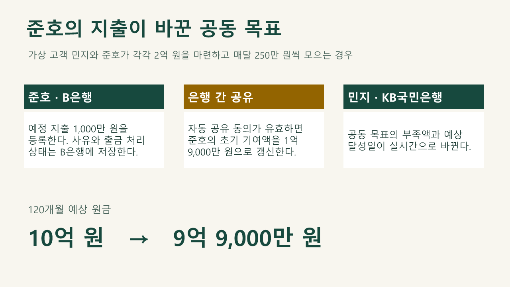

# 신혼집 자기자금 계획 · 요구사항 정의서

민지와 준호는 서로 다른 은행을 쓰며 신혼집에 필요한 자기자금 10억 원을 모은다. 준호에게 예정 지출이 생기면 민지는 자신의 은행에서 목표일이 얼마나 달라지는지 확인하고, 두 사람은 수정된 계획을 각자 승인할 수 있어야 한다.

| 가정 | 민지 · KB국민은행 | 준호 · B은행 |
|---|---:|---:|
| 은행별 출금가능액 | 2억 500만 원 | 2억 500만 원 |
| 비상금 | 500만 원 | 500만 원 |
| 월 납입 예정액 | 250만 원 | 250만 원 |

## 대표 요청과 인수 조건

| 사용자 요청 | 인수 조건 |
|---|---|
| “우리가 10년 뒤에 10억을 마련할 수 있어?” | 은행별 합성 출금가능액 2억 500만 원, 비상금 500만 원, 월 250만 원을 적용한다. 양쪽 동의 후 최초 예상액 10억 원을 표시한다. |
| “내가 1,000만 원을 써야 해. 월 한도는 유지하고 싶어.” | B은행만 지출 사유를 보관한다. KB에는 부족액 1,000만 원과 122회차 달성이 표시된다. 비상금 변경·납입 누락·실제 납입도 별도 반영한다. |
| “영통에서 상담할 곳과 현재 계좌 잔액을 알려줘.” | 계좌 조회 결과를 보존한다. 지점은 카카오의 이름·주소·장소 링크 또는 조회가 불가능한 이유를 표시한다. |
| “두 달 늘리는 안에 동의해.” | 양쪽 고객이 최신 버전에 승인하면 확정한다. 지연 도착한 이전 버전, 한쪽 승인, 만료된 공유는 해당 버전을 확정할 수 없다. |

## 범위와 검증 기준

은행 두 곳에 가상 고객 한 명씩 배정한다. 자금 계산 단위는 원, 기간은 1~600개월이다. 개설일은 한국 날짜를 사용한다. 은행 계좌·인증은 모킹하고, RAG·부동산 시세 조회·이체·대출 심사는 이번 범위에서 제외했다. 금융결제원 포털의 테스트 관리 권한 제약으로 금융 API 실호출 증빙은 확보하지 못했다. 모킹 경로에서도 조회 실패, 부족액, 동의 철회와 승인 충돌을 재현할 수 있도록 설계를 변경했다.

기능별 인수 기준과 시험 근거는 [요구사항별 셀프 체크](체크리스트.md), 구체적인 실행 결과는 [검증 결과서](검증.md)에서 확인할 수 있다.

[프로젝트 홈](../README.md)
